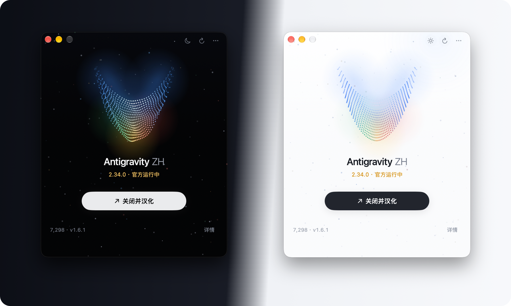

<p align="center">
  
</p>

<h1 align="center">AntigravityZH for Mac</h1>

<p align="center">
  <strong>「反了你了」—— Google Antigravity 原生 macOS 一键中文助手</strong>
</p>

<p align="center">
  <a href="https://github.com/ruaomol/AntigravityZH-for-Mac/releases/latest">
    
  </a>
  
  
  <a href="LICENSE">
    
  </a>
</p>

<br />

## 快速开始

告别敲命令、找路径、手动重签。下载安装包，点一下就好：

1. 前往 [**Releases**](https://github.com/ruaomol/AntigravityZH-for-Mac/releases/latest) 下载 `AntigravityZH-for-Mac-v1.6.1.dmg`。
2. 打开镜像，将 **`AntigravityZH.app`** 拖入 `Applications`。
3. 双击启动，点击 **`一键汉化`** 即可自动完成独立中文应用创建、词典写入、本机签名与启动检查。

> 首次打开若 macOS 提示未公证，右键应用选择「打开」，或执行 `xattr -cr /Applications/AntigravityZH.app`。

<br />

## 界面预览

原生 SwiftUI 打造，60fps 交互式倒置 V 粒子点阵，支持瓷白浅色、黑曜石深色与自动跟随系统切换。

<p align="center">
  
</p>

<br />

## 主要特性

- **不改动官方原版**：默认创建独立应用 `~/Applications/Antigravity 中文.app`，官方客户端与签名原样保留；也支持在设置中切换为「直接替换」。
- **自动检测与定位**：启动即识别官方版本、运行状态与词典更新，支持 Spotlight 自动查找与手动更改应用位置。
- **完整回退与卸载**：一键还原英文原版、移至废纸篓卸载中文版，或彻底清理全部备份与缓存。
- **7,298 条本地词典**：覆盖界面、菜单、右键菜单、对话框与加载画面，纯本地运行，不读取账号与网络请求。

<br />

## 为什么图标是倒过来的？

<p align="center">
  
</p>

<br />

## 从源码构建

需要 macOS 14+ 与 Xcode Command Line Tools：

```bash
# 编译 AntigravityZH.app
./macos-app/build-app.sh

# 打包标准 DMG 安装镜像（输出至 dist/）
./macos-app/build-dmg.sh
```

保留原有命令行脚本供自动化调用：`./install-macos.sh` · `./launch-macos.sh` · `./restore-macos.sh`。

<br />

## 番外 · 一键中文之后

<p align="center">
  
</p>

<br />

## 致谢与参考

- 核心中文词典、翻译引擎与补丁方案参考并改编自开源项目：[**yunjuanyunshu114-byte/antigravity-zh-plugin**](https://github.com/yunjuanyunshu114-byte/antigravity-zh-plugin)（保留原 MIT 许可证与版权声明）。
- 本工具仅修改本地客户端资源，非 Google 官方语言包；不收集任何隐私、账号凭据或遥测信息。

<br />

<p align="center">
  
</p>

<p align="center">
  <sub>如果觉得顺手，欢迎点个 Star ⭐</sub>
</p>
